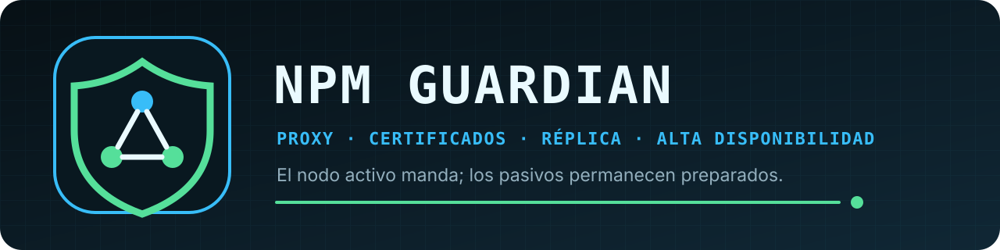

<p align="center">
  
</p>

<p align="center">
  
  
  <a href="LICENSE"></a>
</p>

# NPM Guardian

NPM Guardian mantiene sincronizados varios nodos de Nginx Proxy Manager. Toma como origen
el nodo que posee la dirección flotante y replica la base de datos, la configuración y los
certificados hacia los nodos pasivos.

Toda la aplicación se ejecuta en un único contenedor para Linux `amd64` y `arm64`.

## Qué ofrece

- Detección del nodo activo mediante Keepalived.
- Réplica validada de SQLite, configuración y certificados.
- Copias de seguridad antes de reemplazar datos.
- Renovación DNS y sincronización automática.
- Incorporación segura de nuevos nodos.
- Panel web con estado, diferencias y ejecución manual.
- Configuración persistente desde la propia aplicación.

## Requisitos

- Una instalación de Nginx Proxy Manager en cada nodo.
- Acceso a sus directorios `data` y `letsencrypt`.
- Socket Docker local para detener y arrancar únicamente el NPM configurado.
- Keepalived accesible para determinar qué nodo está activo.
- Un volumen persistente propio para Guardian.

## Instalación con Docker

Sustituye las rutas por las de tu Nginx Proxy Manager:

```bash
sudo mkdir -p /srv/npm-guardian

sudo docker run -d \
  --name npm-guardian \
  --restart unless-stopped \
  --init \
  --read-only \
  --cap-drop ALL \
  --security-opt no-new-privileges \
  --pids-limit 256 \
  --tmpfs /tmp:rw,noexec,nosuid,nodev,size=64m \
  --add-host host.docker.internal:host-gateway \
  -p 6061:6061 \
  -v /ruta/npm/data:/npm \
  -v /ruta/npm/letsencrypt:/npm-letsencrypt \
  -v /srv/npm-guardian:/datos \
  -v /var/run/docker.sock:/var/run/docker.sock \
  ghcr.io/ezr43l/npm-guardian-s:stable
```

Abre `http://SERVIDOR:6061` y completa el asistente. Configura primero un nodo sin
código de incorporación y utiliza el código generado para añadir el resto.

También puedes usar [Docker Compose](docker-compose.yml), la
[guía de instalación](docs/instalacion-primer-arranque.md) o la
[plantilla para Unraid](unraid/my-NPM-Guardian.xml).

## Funcionamiento

Sólo el nodo activo puede iniciar una réplica. Antes de aplicar datos en un destino,
Guardian valida el paquete, conserva una copia local, detiene Nginx Proxy Manager,
reemplaza los datos y vuelve a arrancarlo.

Si no puede demostrar cuál es el activo, no replica. La interfaz muestra las diferencias
y el nodo que contiene la copia más reciente para evitar una sustitución a ciegas.

## Persistencia

El volumen `/datos` contiene la identidad del nodo, la configuración del grupo,
credenciales internas, respaldos y estado operativo. Consérvalo en las actualizaciones y
protégelo como información sensible.

## Seguridad

El socket Docker concede acceso elevado al servidor. No publiques el panel directamente
en Internet y limita su acceso mediante red privada, cortafuegos o un proxy HTTPS.
Comprueba siempre que las rutas montadas pertenecen al NPM local correcto.

Documentación:

- [Arquitectura](docs/arquitectura.md)
- [API de integraciones](docs/api-integraciones.md)
- [Historial de cambios](CHANGELOG.md)

## Soporte

El soporte se presta en la comunidad de Discord de Unraides:

https://discord.gg/8MAT6ZGJTW

No compartas contraseñas, tokens, certificados ni registros con datos privados.

## Licencia

Código y documentación: [Apache License 2.0](LICENSE).

